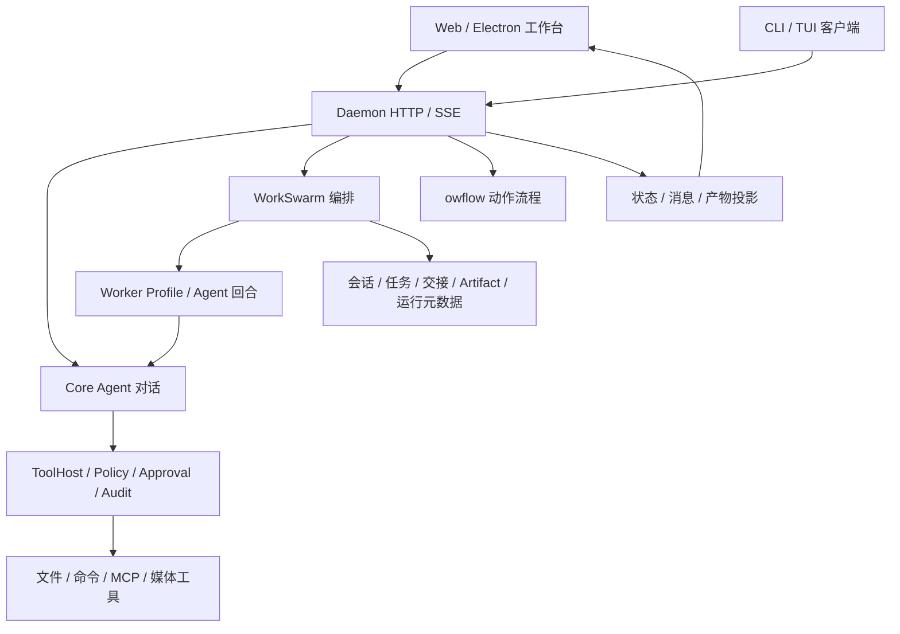

# 项目架构、对话、团队与自定义工作流全链路审查

日期：2026-10-24。范围：`agent-sdk/` 当前工作树，重点是 Web/Electron 共用工作台、Daemon、Core、WorkSwarm、工作流与多模态接线。

**总体判断：现有分层和执行基础值得保留，但“AI 搭建并修改工作流 → 像 ComfyUI 一样连线 → 实时看到消息、任务和媒体产物”的完整产品链路尚未闭合。** 主要问题是同一能力在不同入口使用不同注册表、工具清单、数据协议和状态视图。继续只调整页面外观，无法解决这些问题。

本次已暂停前端修改，没有修复业务源码。报告中的方案均为建议；不代表已经实现。

## 1. 直接回答本次关心的问题

| 问题 | 当前结论 | 具体边界 |
| --- | --- | --- |
| 基本对话是否有真实执行链路？ | 有 | HTTP/SSE → Agent → 模型/ToolHost → 审批与审计；图片输入有真实模型适配。当前没有重新进行真实云模型对话验收。 |
| 团队是否是真正的多角色执行？ | 是 | 有角色、依赖、会话、Worker、写范围、交接、任务状态和产物；不是只有前端卡片。 |
| 能否像拖组件一样搭工作流？ | 目前主要能拖布局 | 工作流图由角色 `depends_on` 生成；拖动只改浏览器位置。没有完整的端口连线、类型匹配、增删节点与执行语义同步编辑。 |
| 能否实时看到团队消息和任务处理？ | 部分做到 | 有团队对话、交接记录、工具卡片、进度 SSE 和任务 DAG；对话另每 2 秒轮询，图和消息未形成统一关联的执行视图。已复现图的连线坐标错误。 |
| AI 能根据指令搭建自定义工作流吗？ | 有生成和保存能力，但链路有缺口 | 有 `/workflows/draft`、收敛、验证、采纳及 `workflow_author` 工具；后者与列表/建队使用不同目录，存在“生成保存后其它入口找不到”的源码级问题。 |
| 工具列表是否完善到足以让 AI 正确编排？ | 尚未统一 | 页面显示主会话工具，AI 草稿使用另一套默认词表，Worker 又有自己的实际工具集。结构校验通过不等于工具当前可执行。 |
| 建好后能否让 AI 修改？ | 支持草稿改进，但不够可靠 | 可基于已有模板及运行证据重新生成；缺少统一的读取/补丁操作、预期版本校验和语义差异确认。当前多数是整份 JSON 重写。 |
| 工作流是否是 JSON，因此容易改？ | 是 JSON，但不等于随意改都安全 | 角色、依赖、工具、模型、写范围都可表达；缺稳定节点 ID、端口类型、版本并发控制、可移植布局等。还同时存在另一套 `.owflow` JSON 语言。 |
| 是否支持文生图、语音和图片理解？ | 有部分真实实现 | 有 `generate_image`、`text_to_speech`、主对话图片输入、本地 STT；媒体输出预览有确定性截断问题。当前检查实例缺本地 STT/OCR 模型，未验证云端媒体接口。 |
| 页面是否能正常处理多模态？ | 不能认定完整正常 | 部分图片/音频渲染入口存在，但结果可能因截断解析失败；大文件只有路径。团队图片输入、历史重放和统一视频产物视图也没有闭合。 |

这里将用户提到的“闻声图”按“文生图”理解，同时覆盖图片理解、语音输入、语音合成和视频边界。

## 2. 本次证据与验证边界

### 2.1 实际执行了什么

- 对当前源码追踪了客户端 → HTTP/SSE → Core/WorkSwarm → 工具、权限、存储、产物 → 页面渲染的相关路径。
- 重新运行 Web 前端全部 94 个测试文件：**1071 项通过，0 失败，耗时约 19.3 秒**。这证明当前测试覆盖的行为通过，不证明真实模型、原生依赖和产品全流程通过。
- 使用实际前端模块做离线复现：媒体结果 JSON 截断后无法解析；任务 DAG 连线横坐标错误；核对默认草稿词表缺媒体工具。
- 在已有本地工作台只读检查工具目录、工作流编辑器及已有团队记录，没有创建新团队、生成新草稿或点击运行/重试/采纳。
- 对现有隔离后端做健康、设置、列表及状态读取；调用无持久化的模板校验；用 1 秒合成静音验证 STT 错误，不涉及麦克风或云端请求。
- `git diff --check` 通过；`python scripts/check-agent-boundary.py` 通过。

### 2.2 不能从本次证据推出什么

本地运行实例报告：commit `3e370fde3016694cf705a93d046609c34722f0ec`，构建时间 `2026-10-22T15:35:15Z`，dirty=true，API 0.7。其模型设置是 `local-ui-fixture`，`cloud_enabled=false`。**该实例早于本次检查，不能作为当前全部 Rust 修改已编译或真实模型可用的证据。**

本次没有运行 Cargo 编译或 Rust 测试，没有调用真实图像/TTS/聊天服务，没有新跑完整 AI 团队，没有进行麦克风、Electron 安装包或发布验收。报告分别标明源码推导、前端复现和已有二进制探测。

开始时工作区有 169 个已有修改/未跟踪状态项。对 4394 个既有源文件/配置做哈希比对，前端与核心生产源码未被本次审查修改。结束前检测到 `team-runs/parkour3d-workflow.json` 变化及其 4 个测试文件消失；本次审查没有编辑这些文件，未据此恢复、覆盖或判定变化来源。详见保存的比对结果。新增内容仅为本报告和证据目录。

### 2.3 可复查证据

- [前端测试完整日志](T:/创新创业/OwO-master/agent-sdk/docs/qa/evidence/2026-10-24-architecture-audit/frontend-tests.log)
- [离线探针源码](T:/创新创业/OwO-master/agent-sdk/docs/qa/evidence/2026-10-24-architecture-audit/audit-probes.mjs) 与 [探针结果](T:/创新创业/OwO-master/agent-sdk/docs/qa/evidence/2026-10-24-architecture-audit/audit-probes.log)
- [已有后端只读快照](T:/创新创业/OwO-master/agent-sdk/docs/qa/evidence/2026-10-24-architecture-audit/runtime-readonly.json) 与 [校验/STT 探测](T:/创新创业/OwO-master/agent-sdk/docs/qa/evidence/2026-10-24-architecture-audit/runtime-probes.json)
- [既有文件保留检查](T:/创新创业/OwO-master/agent-sdk/docs/qa/evidence/2026-10-24-architecture-audit/preservation-check.json)
- [工作流工具列表截图](T:/创新创业/OwO-master/agent-sdk/docs/qa/evidence/2026-10-24-architecture-audit/workflow-editor-audit.jpg)、[团队检查截图](T:/创新创业/OwO-master/agent-sdk/docs/qa/evidence/2026-10-24-architecture-audit/team-dag-audit.jpg)。截图中的团队为已有人工节点验收样例，不是本次新完成的 AI 模型执行。

离线探针可在仓库根目录执行 `node agent-sdk/docs/qa/evidence/2026-10-24-architecture-audit/audit-probes.mjs`。其中默认词表检查是当前源码成员检查，不能替代 Rust 执行。

## 3. 架构是否合理

### 3.1 合理且应保留的部分



共享 Daemon 避免多个客户端各自维护第二套 Agent、会话和 MCP 状态。协议与客户端层、Core 执行层、Server 接线层及 WorkSwarm 契约/存储的职责方向基本正确。权限、审批和实际工具执行存在独立边界；写范围、资源租约、恢复和交接也有实质实现。

团队已有结构化交接，不应重新造一个仅以聊天文本串接的调度器。`HandoffRecord` 包含上下游、摘要、产物引用、证据与风险。运行创建时也已经将解析后的 `roles: specs` 写入 `RunMeta`，并保存父上下文引用；不能说运行只存了模板 ID、完全没有快照。后续需补模板 revision/hash 等溯源，而不是另建一套运行配置。

源码依据：[协议交接记录](T:/创新创业/OwO-master/agent-sdk/crates/owo-agent-protocol/src/lib.rs:473)、[运行快照](T:/创新创业/OwO-master/agent-sdk/crates/owo-agent-core/src/workswarm/coord_create.rs:594)、[Worker 工具装配](T:/创新创业/OwO-master/agent-sdk/crates/owo-agent-core/src/worker_profile.rs:605)。

### 3.2 当前最需要收敛的是同一能力的多套口径

| 领域 | 当前分歧 | 收敛方向 |
| --- | --- | --- |
| 模板存储 | Tool、REST、草稿、建队各自构造注册表路径 | 一个注册表服务/工厂，经 AppState 注入 |
| 工具能力 | 主 Agent、草稿词表、Worker、页面目录不同 | 从实际运行档投影统一能力目录 |
| 工作流编辑 | JSON 模板、浏览器布局、团队运行图分离 | 一个规范化文档，编辑和运行视图围绕稳定节点 ID |
| 多模态结果 | 人读预览、文件路径、base64 与 UI JSON 解析混用 | 结构化 ArtifactRef 与独立内容读取 |
| 运行观测 | 进度 SSE、会话轮询、任务查询、交接记录分别呈现 | 有序运行事件 + 可重建状态投影 |
| 模型可用性 | 设置存在、工具注册、端点就绪与实际支持混同 | 区分 configured / connected / verified / unavailable |

不建议为了模仿 ComfyUI 而替换现有权限和 WorkSwarm 内核，也不建议再增加一套平行的模板库或工具注册表。

### 3.3 两种“工作流”必须讲清楚

**团队工作流**是 `TeamTemplate`：角色、依赖、Worker、模型、工具和交接契约，由 WorkSwarm 执行。入口是 `/workflows/user`、`/workflows/draft`、`/teams`。

**动作工作流**是 `.owflow` 的 `WorkflowDefinition`：触发器、权限、前置条件、回滚点和步骤，支持 Sense/Locate/Act 等动作及控制结构。入口是 `/workflow` 系列。其页面默认存在明确标注的 mock 后端选项，不能把该选项跑通当成真实桌面自动化验收。

两者都是 JSON，但语义和执行器不同。AI `workflow_author` 当前针对 TeamTemplate，不是通用 `.owflow` 作者。建议保留两种执行后端，在产品层标明“团队编排”和“动作流程”；先统一版本、资产、能力、事件与导入导出包，再按需提供显式转换适配。不能仅把扩展名统一就宣称合并完成。

依据：[TeamTemplateRole](T:/创新创业/OwO-master/agent-sdk/crates/owo-agent-protocol/src/lib.rs:590)、[动作步骤与定义](T:/创新创业/OwO-master/agent-sdk/crates/owo-agent-workflow/src/workflow/mod.rs:98)、[动作流程路由](T:/创新创业/OwO-master/agent-sdk/crates/owo-agent-server/src/workflow_api.rs:3)、[动作页面后端选择](T:/创新创业/OwO-master/agent-sdk/desktop/web/panels/workflow.panel.js:79)。

## 4. 优先问题及可实施修复

优先级含义：P1 是会直接破坏目标链路或造成错误判断的问题；P2 是可靠性、可维护性及体验缺口。没有把未经验证的候选风险标成已发生的安全事故。

### F1 · P1：对话 AI 保存工作流与列表、建队不在同一目录

**证据等级：当前源码确定；目录现状只读核对；未调用真实模型执行作者工具。**

`TeamTemplateRegistry::new(root)` 会再追加 `templates/`。但是：

- `server/src/lib.rs:342` 给 `WorkflowAuthorTool` 传入 `data_root/workswarm`；作者工具内部再次创建 Registry。
- `user_workflows_api.rs:47`、`workflow_draft_api.rs:319`、`workswarm_api/state.rs:36` 等传入 `data_root/workswarm/templates`。
- `team_template_catalog_api.rs:32` 还明确记录了双层 `templates/templates` 是现存兼容布局。

因此实际文件位置分别是：

```text
对话 workflow_author → data_root/workswarm/templates/<id>.json
列表/草稿采纳/团队 → data_root/workswarm/templates/templates/<id>.json
```

本地已有目录也呈现单层为空、双层有模板。**直接后果：AI 工具返回保存成功后，用户列表或建队仍可能找不到它。** 这是 AI 搭建链路的优先修复项。

建议先让作者工具使用与现有 REST 一致的注册表实例/路径，保持已有数据可见；把路径构造集中到一个服务。若之后简化双层目录，单独做带备份、ID/内容冲突检查的迁移，不能直接删除一层或静默覆盖。

验收：用隔离数据根执行作者工具创建 → REST 列表可见 → 按同一 ID 建队 → 重启仍可见；已有双层模板和重名模板均有迁移回归。

源码：[作者工具注册](T:/创新创业/OwO-master/agent-sdk/crates/owo-agent-server/src/lib.rs:342)、[作者保存](T:/创新创业/OwO-master/agent-sdk/crates/owo-agent-server/src/workflow_author_tool.rs:200)、[Registry](T:/创新创业/OwO-master/agent-sdk/crates/owo-agent-core/src/workswarm/registry.rs:12)、[REST 注册表](T:/创新创业/OwO-master/agent-sdk/crates/owo-agent-server/src/user_workflows_api.rs:47)、[现存路径说明](T:/创新创业/OwO-master/agent-sdk/crates/owo-agent-server/src/team_template_catalog_api.rs:32)。

### F2 · P1：媒体工具成功，页面仍可能没有图片/音频

**证据等级：当前源码 + 实际前端解析模块的离线复现。**

媒体工具对不超过 512 KiB 的结果返回含 `data_url` 的 JSON。Agent 的 `tool_result_preview` 只保留 1600 字符；HTTP 和团队会话传递该预览。页面又将预览当成完整 JSON 解析，以提取路径、图片和音频。

复现：仅 1200 字节的合成媒体，序列化 JSON 已达 1701 字符；完整输入可解析，按当前上限截断后 `mediaFromToolResult` 解析失败，连 `path` 都取不到。4096 字节同样失败。超过内联上限的结果虽然 JSON 变短，但页面主要只提供路径，缺通用的受认证文件预览链路。

这意味着结果能否显示会随文件大小出现反直觉变化。提高 1600 上限无法从根本上解决 base64、SSE 流量和大文件问题。

建议给工具结果增加独立、不可截断的结构化 `outputs: ArtifactRef[]`，保留短预览供阅读；将媒体文件登记到现有 Artifact/CAS 体系，复用并扩展鉴权内容接口按需获取。现有 `/artifacts/{id}/content?raw=true` 已能交付登记产物的原始字节，问题是媒体工具结果没有一致接入这条链路，不是项目完全没有产物下载能力。主对话、团队和历史重放共用一个渲染器。不得依赖从展示文本反解析业务数据。

验收：2 KiB、100 KiB、1 MiB 的图片和音频，在主对话/团队/重载历史中均可显示；同时测试取消、文件不存在、权限拒绝、错误 MIME，不把大 base64 放进消息流。

源码：[媒体内联](T:/创新创业/OwO-master/agent-sdk/crates/owo-agent-core/src/tools/media.rs:160)、[预览上限](T:/创新创业/OwO-master/agent-sdk/crates/owo-agent-core/src/agent/mod.rs:849)、[主页面解析](T:/创新创业/OwO-master/agent-sdk/desktop/web/core/media-result.js:9)、[主页面展示](T:/创新创业/OwO-master/agent-sdk/desktop/web/app.js:1518)、[团队展示](T:/创新创业/OwO-master/agent-sdk/desktop/web/panels/workswarm/render_conversation.js:308)。

### F3 · P1：团队任务图的依赖连线坐标错误

**证据等级：当前渲染函数离线复现 + 实际页面 DOM 核对。**

`render.js:567` 拼接 `<line x1>` 时使用 `字符串 + s.x + NW`，没有先计算 `(s.x + NW)`。两个节点的测试中应为 `222`，实际得到 `12210`，SVG 宽度只有 `504`。已有团队页面 DOM 也读到 `x1=12210`、`x2=277`。

影响：箭头可能从画布外连接，依赖关系被错误呈现。当前前端 1071 项测试仍全绿，说明相关测试验证了文本/标记，没有覆盖关键几何值。

建议先修数值求值并提取纯几何计算，补 2 节点、分支汇合、失败重试的坐标范围与截图检查。本次按要求未改页面代码。

源码：[DAG 渲染](T:/创新创业/OwO-master/agent-sdk/desktop/web/panels/workswarm/render.js:544)、[现有相关测试](T:/创新创业/OwO-master/agent-sdk/desktop/web/tests/workswarm.panel.test.mjs:254)。

### F4 · P1：工具目录、AI 草稿和实际 Worker 能力不同

**证据等级：源码 + 当前页面/后端工具列表 + 结构校验探测。**

页面由 `/settings` 读取主 Agent 的 `active_tool_names`。本次实例列出 30 个工具，包括 `workflow_author`、`subagent`、`fan_out_subagents`、`read_image`、`generate_image` 和 `text_to_speech`。这不是“当前工作流节点都可执行的工具列表”。

草稿 API 的默认工具词表主要是固定基础文件/命令工具，再加特定 MCP、浏览器及 Web 工具；**默认漏掉文生图和语音合成**。当前草稿提示词已经包含工具描述的截取内容，不能沿用“AI 只收到名字、完全没有描述”的旧判断；但它仍缺统一参数 schema、作用域、模型模态及可用性信息。

Worker 又通过自己的运行档组装工具，再代理选定的 MCP/Web/媒体工具。例如主会话目录里的部分编辑工具没有被这一 Worker 注册链路装配。运行时会检查缺失工具并报错，保持拒绝执行，但发现太晚。

本次向无持久化校验接口提交格式合法、实际未连接的 `mcp__audit_absent__no_tool`，返回 `ok:true`；循环依赖则正确返回 `ok:false`。因此这里的“校验成功”主要表示结构/命名合法，不能显示成“工具当前可运行”。这不是已证明的权限绕过。

建议从真实 Worker Profile、工具注册表、策略和连接状态生成统一能力目录，供页面、草稿 AI 和运行预检共用。至少包括名称、说明、参数 schema、输入/输出模态、执行效果、所需权限、运行档支持情况、模型要求、可用状态及不可用原因。允许保存尚未配置的工具，但明确标记“需配置”；启动前拒绝并指出具体节点。

验收：目录中的“可用”工具都能由对应运行档构建；未连接 MCP、主会话专用工具和缺媒体配置有明确原因；AI 起草文生图流程能选择已注册的媒体工具。

源码：[设置投影](T:/创新创业/OwO-master/agent-sdk/crates/owo-agent-server/src/settings_api/mod.rs:27)、[页面目录](T:/创新创业/OwO-master/agent-sdk/desktop/web/panels/workflows.panel.js:258)、[草稿词表](T:/创新创业/OwO-master/agent-sdk/crates/owo-agent-server/src/workflow_draft_api.rs:65)、[代理允许集](T:/创新创业/OwO-master/agent-sdk/crates/owo-agent-core/src/agent/workflow_tools.rs:44)、[Worker 构建](T:/创新创业/OwO-master/agent-sdk/crates/owo-agent-core/src/worker_profile.rs:605)、[缺失工具检查](T:/创新创业/OwO-master/agent-sdk/crates/owo-agent-core/src/worker_profile/runner.rs:121)。

### F5 · 产品关键缺口：拖动只改布局，尚非图式工作流编辑器

**证据等级：源码 + 当前工作流页面只读检查。**

节点位置存于浏览器 `localStorage`，键主要是模板 ID；拖动结束仅保存位置。页面也明确提示“仅界面，不改配置”。依赖来自模板的 `depends_on`，编辑语义主要仍是整份 JSON 文本框。

所以目前“可拖画布”适合查看/整理角色，不等于用户能拖出一个工具节点、拉端口连线、修改参数并让执行图随之变化。布局也没有随模板导出，且缺 Daemon/工作区命名空间，不同实例同 ID 可能共享错位布局。

建议在现有模板执行器上增量实现节点增删、依赖增删、节点配置表单与即时校验，JSON 和画布双向同步。位置变化只改布局，连线变化才改变执行依赖。先支持现有角色节点，再引入独立工具节点，避免同时重写所有调度语义。

验收：鼠标连接与 JSON 修改得到同一规范化文档；循环/缺节点即时标注；导入导出保留结构和可选布局；节点重命名不破坏历史映射。

源码：[布局持久化](T:/创新创业/OwO-master/agent-sdk/desktop/web/panels/workflows.panel.js:193)、[拖动处理](T:/创新创业/OwO-master/agent-sdk/desktop/web/panels/workflows.panel.js:339)、[JSON 保存](T:/创新创业/OwO-master/agent-sdk/desktop/web/panels/workflows.panel.js:951)、[图布局模块](T:/创新创业/OwO-master/agent-sdk/desktop/web/core/workflow-editor.js)。

### F6 · P1/P2：AI 可以改流程，但缺安全、可审阅的版本化补丁

**证据等级：当前源码；未做并发写入破坏性实验。**

已有能力包括：`based_on` 读取已存模板；`refine_of` 改进草稿；基于运行证据重新生成；有界收敛、校验、采纳。因此不能说“完全不能 AI 修改”。

不足在于：

1. `workflow_author` 主要接收完整模板与覆盖开关，没有成套的专用 list/get/patch 工具。已有模板不在普通工作区读文件的自然范围内；AI 缺少可靠的发现和读取入口。
2. 作者工具对模型、Worker 等字段的参数描述不如实际协议完整；AI 所见 schema 与可表达能力不完全一致。
3. Registry 直接写 JSON 文件，没有原子替换、`expected_revision`、冲突检测和完整修订历史。模板 `version` 是社区演进版本，不等于并发控制 revision。两个编辑者覆盖同一 ID 的丢失更新风险存在。
4. REST、草稿采纳和作者工具对于覆盖/来源的规则也不完全一致；应统一到服务层，不能分别补判断。

建议增加 `workflow_list`、`workflow_get`、`workflow_propose_patch`、`workflow_validate`，修改返回“基于哪个 revision、哪些节点/边/参数变化、影响哪些写权限”的提案；经现有审阅/采纳入口应用。底层使用原子写或事务存储，加预期版本与修订历史。权限扩大继续走既有审批，不让 AI 作者给自己授权。

正在运行的 Team 继续使用已有 RunMeta 快照；编辑产生下一版，不静默改变正在执行的节点。运行中需要调整时，沿用明确的 steer/恢复接口。补模板内容 hash/revision 的运行溯源即可，无需推翻现有快照。

验收：基于旧 revision 的补丁返回冲突；AI 只改指定节点；语义 diff 可读；重命名不误删依赖；重启可回看旧版；运行中的任务配置不被模板编辑偷换。

源码：[作者工具 schema](T:/创新创业/OwO-master/agent-sdk/crates/owo-agent-server/src/workflow_author_tool.rs:113)、[草稿改进](T:/创新创业/OwO-master/agent-sdk/crates/owo-agent-server/src/workflow_draft_api.rs:437)、[收敛](T:/创新创业/OwO-master/agent-sdk/crates/owo-agent-server/src/workflow_draft_api.rs:660)、[采纳](T:/创新创业/OwO-master/agent-sdk/crates/owo-agent-server/src/workflow_draft_api.rs:923)、[直接写入](T:/创新创业/OwO-master/agent-sdk/crates/owo-agent-core/src/workswarm/registry.rs:20)。

### F7 · P2：已有实时观测，但任务、消息和数据流尚未统一

**证据等级：源码；已有团队历史记录只读观察。**

服务端有容量 64 的进度 SSE 通道，约每 500ms 观察状态/审计变化。前端同时每 2 秒拉团队会话，用序列游标合并；任务 DAG、交接和成员会话分开显示。这能看到执行情况，但不能像数据流画布那样追踪“这个节点向那个节点传了哪一个资产、由哪次工具调用产生、为什么下游等待”。

会话合并后长期保留历史事件，渲染时重建全部消息/工具卡片；单次后端拉取虽有限额，不代表前端历史与 DOM 有总量上限。长团队的内存和重绘成本会增长。当前实现还要扫描会话后再筛团队前缀，团队/会话总量增大后应做索引。

建议统一运行事件信封：`seq/run_id/node_id/task_id/attempt/event_type/causation_id/tool_call_id/artifact_refs/timestamp`；持久化事件与状态投影可恢复，前端主要订阅 SSE，轮询仅作回退。图上显示公开消息、交接摘要、工具参数/结果、产物和等待原因，点击边查看实际传递的 ArtifactRef；不需要展示模型私有推理过程。

验收：断线从 seq 恢复不重不漏；失败、取消、重试归属明确；有界队列和慢客户端回收；万条事件下分页/虚拟列表仍稳定；停止/离开页面取消订阅。

源码：[团队 SSE](T:/创新创业/OwO-master/agent-sdk/crates/owo-agent-server/src/workswarm_api/team_observability.rs:47)、[会话拉取](T:/创新创业/OwO-master/agent-sdk/crates/owo-agent-server/src/workswarm_api/conversation.rs:45)、[前端轮询](T:/创新创业/OwO-master/agent-sdk/desktop/web/panels/workswarm.panel.js:2645)、[事件合并与渲染](T:/创新创业/OwO-master/agent-sdk/desktop/web/panels/workswarm/render_conversation.js:138)。

### F8 · P1/P2：主对话图片输入已接通，团队与工具读图不等价

**证据等级：当前源码；未发送用户图片或真实视觉模型请求。**

主回合把合规图片附件转成 `MessageImage`；OpenAI 兼容适配器输出 image_url 内容块，Anthropic 适配器输出图片块。这是真实多模态接线。

但 `read_image` 工具返回的是 base64 JSON/说明，普通工具结果进入文本消息，不自动变成模型图片输入。Worker 的当前运行入口接收 `prompt: &str`，没有与主会话一致的结构化图片附件输入。不能认为“Team 角色能读文件”就等于“该模型看到了图片像素”；MCP 外部视觉工具也属于另一条需独立验证的路径。

历史渲染主要处理消息 content；编辑、重发也偏文本。图片附件的历史展示与重发保真没有形成与初次发送一致的统一协议。上传接口另有 50MB 原始大小检查，但路由 JSON body 限制为 32MB，加上 base64 开销，实际不能承诺 50MB 文件都能上传；主对话图片又限制 5MB。前端应在读完整文件前展示准确的类型/大小限制。

建议以 `ContentPart` 和受控 AssetRef 表达 text/image/audio/video/file，服务端持久化引用；主对话和 Team 任务输入使用同一结构。模型适配器按能力解析图片，不把 base64 当普通文本。重发保留引用并重新鉴权。统一上传配额、前端提示与流式接收。

验收：同一图片主对话与 Team 均确实进入视觉模型请求；历史重载/重发不丢图；文本模型接收图片前有明确不支持提示；超限/不支持文件早失败；越权资产不可读。

源码：[回合附件](T:/创新创业/OwO-master/agent-sdk/crates/owo-agent-server/src/turn_api/handlers.rs:130)、[OpenAI 图片适配](T:/创新创业/OwO-master/agent-sdk/crates/owo-agent-core/src/gateway/provider.rs:424)、[Anthropic 图片适配](T:/创新创业/OwO-master/agent-sdk/crates/owo-agent-core/src/anthropic.rs:280)、[read_image](T:/创新创业/OwO-master/agent-sdk/crates/owo-agent-core/src/tools/image.rs:10)、[Worker 文本入口](T:/创新创业/OwO-master/agent-sdk/crates/owo-agent-core/src/worker_runtime.rs:74)、[历史渲染](T:/创新创业/OwO-master/agent-sdk/desktop/web/app-domain.js:1085)、[上传限制](T:/创新创业/OwO-master/agent-sdk/crates/owo-agent-server/src/session_api.rs:442)、[路由限制](T:/创新创业/OwO-master/agent-sdk/crates/owo-agent-server/src/routes.rs:57)。

### F9 · P2：媒体模型配置与“可用”状态需要更准确

**证据等级：源码 + 现有实例状态探测。**

图像生成和 TTS 分别请求兼容接口 `/images/generations`、`/audio/speech`。但两者共享 `OWO_IMAGE_BASE_URL` / `OWO_IMAGE_API_KEY` 等回退路径；默认图像和 TTS 模型不同，却没有同等独立的 TTS 连接配置。聊天页面选中的 `model_connection` 不会自动替换媒体工具端点。

能力注册中的媒体 ready 判定主要看端点/环境配置，图像与语音共享一个 ready 布尔值。配置存在不能证明服务支持这两个接口、模型授权和输出格式。当前实例本地 STT 实测返回缺模型；OCR 状态是 engine_created=true 但 onnx_models_present=false；视觉状态的 Ollama 模型列表为空。不能把这些展示为完整可用。

建议给 chat、vision、image generation、TTS、STT 建立可独立选择但可复用凭据引用的连接档；状态分为未配置、已配置、连接失败、已验证及最后验证时间。能力目录显示真实缺失原因。验证调用应有明确预算和用户触发，避免页面刷新自动产生付费媒体请求。

源码：[媒体端点与请求](T:/创新创业/OwO-master/agent-sdk/crates/owo-agent-core/src/tools/media.rs:398)、[媒体 ready 判定](T:/创新创业/OwO-master/agent-sdk/crates/owo-agent-server/src/capabilities.rs:431)、[本地 STT](T:/创新创业/OwO-master/agent-sdk/crates/owo-agent-server/src/assist_api.rs:117)、[STT 模型检查](T:/创新创业/OwO-master/agent-sdk/crates/owo-agent-perception/src/stt.rs:100)。

### F10 · P2，需定向验证：媒体写路径与角色声明不一致

**证据等级：源码风险，未做越权执行实验，不能认定已发生安全绕过。**

媒体输出会取请求路径的文件名部分，统一落在工作区 `outputs/`。它检查工作区、输出目录和符号链接；但没有直接复用普通文件写工具的角色路径白名单。Worker 对未声明写范围的媒体角色默认补 `outputs/`，这部分是合理保护；若显式声明 `images/`，工具仍落 `outputs/`，会与角色意图及写租约分配不一致。草稿提示词又曾推荐声明 `images/`，因此不是纯理论配置。

建议在执行宿主中统一解析和授权最终输出路径，纳入角色/任务写范围与租约后再发外部请求；媒体工具只写宿主交付的安全目标。需补“允许 images/、禁止 outputs/”及并发角色输出冲突测试，验证实际策略效果后再定级。

另一个可改点：远端图片 URL 下载已有流式上限；但部分 JSON/base64 图像响应及 TTS 音频先完整读取再检查文件大小，不能把落盘大小上限当成网络读取内存上限。应对所有响应路径做受限读取和解码预算。

源码：[输出路径](T:/创新创业/OwO-master/agent-sdk/crates/owo-agent-core/src/tools/media.rs:90)、[媒体落盘](T:/创新创业/OwO-master/agent-sdk/crates/owo-agent-core/src/tools/media.rs:236)、[媒体默认写范围](T:/创新创业/OwO-master/agent-sdk/crates/owo-agent-core/src/worker_profile.rs:165)、[代理执行](T:/创新创业/OwO-master/agent-sdk/crates/owo-agent-core/src/agent/workflow_tools.rs:37)、[有界 URL 下载](T:/创新创业/OwO-master/agent-sdk/crates/owo-agent-core/src/tools/media.rs:216)。

## 5. 工作流 JSON 应如何组织

### 5.1 当前格式本身可用，适合角色 DAG

下面是当前 `TeamTemplate` 格式的简化示意，不是本次创建的工作流。是否能执行还取决于当前模型和工具配置。

```json
{
  "template_id": "research-note-v1",
  "name": "检索并撰写笔记",
  "mode": "team",
  "origin": "user",
  "applicability": "检索资料并保存笔记",
  "created_at": "2026-10-24T00:00:00Z",
  "roles": [
    {
      "role": "research",
      "assignee": "agent",
      "worker": "agent",
      "depends_on": [],
      "tools": ["web_search", "web_fetch"],
      "handoff_contract": "交付来源链接与摘要",
      "verify": "non_empty"
    },
    {
      "role": "writer",
      "assignee": "agent",
      "worker": "agent",
      "depends_on": ["research"],
      "tools": ["read_file", "write_file"],
      "write_paths": ["notes/"],
      "handoff_contract": "基于来源撰写 notes/result.md",
      "verify": "non_empty"
    }
  ]
}
```

它已经能表达任意命名的角色和依赖，不应强行恢复固定 writer/reviewer 模板。主要不足是 `role` 同时承担名字与依赖身份，边只表示“等待上游”，没有明确“上游哪个输出接到下游哪个输入”。自由文本 handoff 很灵活，但不足以支撑完整的类型化组件数据流。

### 5.2 建议的第二版文档：先规范化，再增量扩展

以下全部是**建议格式，当前未实现**：

```json
{
  "schema_version": 2,
  "workflow_id": "wf-research-note",
  "revision": 7,
  "name": "检索并撰写笔记",
  "execution_backend": "workswarm",
  "nodes": [
    {
      "id": "n-research",
      "kind": "agent",
      "label": "资料检索",
      "config": {
        "model_ref": "profile-fast",
        "tools": ["web_search", "web_fetch"],
        "instruction": "检索并提供可追溯资料"
      },
      "outputs": [{"name": "evidence", "type": "artifact_set"}]
    },
    {
      "id": "n-writer",
      "kind": "agent",
      "label": "撰写笔记",
      "config": {
        "tools": ["read_file", "write_file"],
        "write_paths": ["notes/"]
      },
      "inputs": [{"name": "sources", "type": "artifact_set"}]
    }
  ],
  "edges": [
    {
      "id": "e-evidence",
      "from": {"node": "n-research", "port": "evidence"},
      "to": {"node": "n-writer", "port": "sources"}
    }
  ],
  "ui": {
    "positions": {"n-research": [80, 120], "n-writer": [420, 120]}
  }
}
```

实现原则：

1. 稳定 ID 与显示名分离；工具、模型和资产采用引用，不把密钥和大 base64 写进工作流。
2. 文档保存结构，Run 保存冻结的编译结果、revision/hash 和运行事件；运行状态不回写污染模板。
3. 初期把角色 DAG 编译为现有 TeamTemplate/WorkSwarm，保持现有审批、写范围与租约；不增设平行调度内核。
4. 首批只提供真实已支持的节点类型。工具、人工、子流程、条件节点逐步增加；未支持类型应明确拒绝，不能保存后默默忽略。
5. 图编辑和 AI 修改共用一套操作命令：增加节点、连接端口、改配置、删除节点。校验相同，AI 没有特殊权限。
6. 导入导出包含 schema、模板、可选布局和资产清单；资产内容按授权单独分发。兼容旧 JSON 的迁移函数应有确定性测试。

### 5.3 AI 修改的建议交互

```text
读取指定 workflow + revision
  → 理解用户要改的范围
  → 返回结构化 patch 与语义 diff
  → 统一校验：结构/环/端口类型/工具可用性/模型/写范围
  → 显示新增权限、资源与受影响节点
  → 用户通过既有采纳入口应用
  → 原子保存新 revision
  → 下一次运行使用新版本；当前运行保持快照
```

这样用户说“把第二步改成生成图片，再加人工确认”，AI 可以修改两个明确节点与连接；不必重新生成整个 JSON，也不会顺带覆盖用户刚调整的其它内容。

### 5.4 对标 ComfyUI 应对标什么

ComfyUI 的工作流 JSON 规范包含节点 ID、位置、输入/输出和链接；节点有可连接的输入/输出类型；服务端有节点执行、进度和错误事件。这些分别对应本项目缺失的文档结构、编辑语义和运行关联。依据：[官方 Workflow JSON](https://docs.comfy.org/specs/workflow_json)、[官方节点概念](https://docs.comfy.org/basic-concepts/nodes)、[官方消息协议](https://docs.comfy.org/development/comfyui-server/comms_messages)。

本项目的 Agent、人工节点、审批和长期任务比普通图像算子复杂。可以采用类似的可视化编辑与事件映射方式，但不能照抄“节点完成就直接执行下游”而绕开交接验证和权限。ComfyUI 的 `executed` 也不是每个节点都无条件发送的通用完成事件；本项目应设计自己的明确终态契约。

## 6. 多模态能力与页面处理矩阵

| 能力 | 当前实现 | 页面与本次状态 | 结论 |
| --- | --- | --- | --- |
| 文本对话 | Agent/gateway 流式文本、工具、审批 | 有页面接线；本次仅现有 fixture 状态检查 | 有真实实现，真实模型未重新验收 |
| 主对话图片输入 | 图片附件 → MessageImage → 两类模型适配器 | 有发送入口；历史/重发保真需补 | 部分完整 |
| 团队图片输入 | Worker 入口主要是文本；可通过外部视觉工具扩展 | 缺统一附件传递和模型请求证据 | 不能视为原生支持闭环 |
| 文生图 | `generate_image` → 兼容图像接口 → outputs 文件 | 图片卡片存在，但有 F2 截断问题 | 工具已实现，端到端未通过 |
| 文字转语音 | `text_to_speech` → `/audio/speech` | audio 控件入口存在，同受 F2 影响 | 工具已实现，服务/播放未实际验收 |
| 语音转文字 | 浏览器录制 WAV → 本地 STT → 填回输入框；另有浏览器识别回退 | 合成静音探测返回本地模型未就绪 | 当前实例不可用，不等于代码没有实现 |
| 实时语音对话 | 未见同等级的双向实时音频会话闭环 | 录音转文字不等于连续音频对话 | 暂不能认定支持 |
| OCR/本地视觉 | 有相应模块、状态接口与模型配置 | OCR 模型缺失，Ollama 模型列表为空 | 配置/依赖未就绪 |
| 视频理解/视频生成 | 本次未发现一条统一内置的生成、输入、结果链路；可走明确连接的扩展 | 当前媒体解析器主要处理图片/音频 | 需要适配器、资产协议与播放器验收 |
| 图像编辑/3D 生成 | 没有发现与文生图同等级的内置完整链路 | 不能把任意 MCP 名称合法视为支持 | 作为明确扩展能力管理 |

### 推荐的媒体数据契约

工具返回小而稳定的产物元数据，例如（建议，未实现）：

```json
{
  "tool_call_id": "call-17",
  "status": "succeeded",
  "summary": "图片已生成",
  "outputs": [
    {
      "artifact_id": "artifact-image-17",
      "mime_type": "image/png",
      "bytes": 245760,
      "sha256": "<content-hash>",
      "kind": "image"
    }
  ]
}
```

客户端复用现有受认证的产物交付体系获取图像/音频/视频，补齐正确 MIME、Range、授权校验、取消和失效提示；现有 JSON 正文路径以文本解码，二进制媒体应使用原始字节路径，不经 UTF-8 有损转换。内部 API 路由本次不预先定死；新增时同步协议、TS 客户端、OpenAPI 和路由契约测试。对外只暴露允许读取的 ArtifactRef，不能根据任意本地路径直接开文件。现有实现可参考 [Artifact 内容交付](T:/创新创业/OwO-master/agent-sdk/crates/owo-agent-server/src/artifact_delivery_api.rs:101)。

模型配置要说明“这个节点实际用了哪条连接、哪个模型、输入输出模态是否匹配”。支持多模态是模型能力、工具能力、输入协议、产物存储和页面渲染共同成立，不能只看模型名字或有一个 image 按钮。

## 7. 其它架构优化与已改善项

### 7.1 按功能切片减少大模块维护成本

当前 `app.js` 约 5989 行、`app-domain.js` 约 3407 行、`workswarm.panel.js` 约 4191 行、`workflows.panel.js` 约 1162 行；Core `agent/turn.rs` 约 1470 行、`tools.rs` 约 2360 行、Server `lib.rs` 约 1387 行、`workswarm_api/workers.rs` 约 1439 行。

行数不是缺陷本身，但工具目录、编辑、运行订阅和渲染散落在大模块中，容易产生本次发现的多套口径。建议围绕明确职责拆出模板仓储服务、能力目录投影、运行事件客户端、统一媒体组件和会话历史组件。先收敛行为契约，再移动代码；避免只添加转发门面而增加更多层。

### 7.2 构建依赖仍应按实际依赖图优化

当前 Core 默认 feature 已为空、Perception 默认 feature 也已收敛，不能照搬旧文档说默认仍启用所有 STT。另一方面，Core 仍关联感知/执行/工作流，Perception 有 ORT 依赖，Server/CLI 仍经 eval-facade 关联评测代码。轻客户端与重宿主依赖边界还有进一步核查空间。

建议下一轮先在资源门禁下记录指定产品 feature 的 `cargo tree` 与构建时间/产物大小，再按需要把重型原生能力留在可选宿主或插件边界。没有实际构建结果前，不声称“已经完全卸载 ORT”或“性能提升多少”。本次未启动重型 Rust 构建。

### 7.3 旧审查问题不能直接当成当前问题

当前 `gateway/stream.rs` 已先处理 usage，`choices:[]` 的历史漏记问题不能继续列为当前确定缺陷。当前 SSE 相关实现已存在有界通道与重放限制，团队进度通道也有容量上限；不能继续笼统宣称“所有 SSE 都无界”。

后续仍应验证慢客户端、断线重放和取消回收，但这属于当前链路验收，而非沿用旧诊断。现有 RunMeta 角色快照、草稿工具描述和动态工具缺失检查也都是应保留的改进。

依据：[当前流式解析](T:/创新创业/OwO-master/agent-sdk/crates/owo-agent-core/src/gateway/stream.rs:26)、[有界事件通道](T:/创新创业/OwO-master/agent-sdk/crates/owo-agent-server/src/event_stream.rs:723)、[SSE 有界转发](T:/创新创业/OwO-master/agent-sdk/crates/owo-agent-server/src/sse.rs:433)。

## 8. 建议实施顺序与验收门槛

按交付里程碑安排，不在没有实现与测试估算时承诺工期。

| 阶段 | 具体工作 | 复用边界 | 通过标准 |
| --- | --- | --- | --- |
| A：先消除确定链路错误 | 统一 Registry；修 DAG 坐标；结构化媒体输出；补对应回归 | 现有模板、ToolHost、Artifact、页面模块 | 作者→列表→建队可见；图线在视口内；多种大小媒体在对话/团队/历史可读 |
| B：让 AI 编排可信 | 统一能力目录；保存前结构校验与运行前可执行预检分层；原子版本存储；读取/补丁工具 | WorkerProfile、现有校验与草稿/采纳入口 | AI 所见可用工具等于运行档真实能力；旧版本补丁冲突；修改 diff 可读 |
| C：真正图式编辑 | 稳定 ID、节点/边操作、配置表单、JSON 双向同步、导入导出 | 初期编译为现有 TeamTemplate | 拖节点、连线、改 JSON 三者一致；环和类型错即时定位；布局可移植 |
| D：运行可观察 | 统一事件信封、产物关联、边数据检查、分页/虚拟列表 | 现有 SSE、会话游标、任务/交接记录 | 断线恢复不重不漏；等待/失败/重试可定位；长任务不无限重绘 |
| E：多模态完整闭环 | ContentPart、AssetRef、独立媒体连接档、Team 多模态输入、统一渲染 | 现有模型适配与媒体工具 | 主对话/Team 请求真实包含图片；STT/TTS/文生图分别验收；视频按实际适配能力登记 |
| F：依赖与模块优化 | 重依赖量化、功能切片、必要原生模块隔离 | 保持一个宿主和一套安全边界 | 实际构建图/启动/内存证据改善，原行为契约不回退 |

### 必须补的测试是链路测试，不是增加数量

1. **工作流持久化**：作者工具创建 → 列表 → 读取 → 建队 → 重启；覆盖原有双层目录兼容和 ID 冲突。
2. **AI 修改**：单节点修改、不相关配置保留、旧 revision 冲突、权限扩大提示、运行快照不变。
3. **能力预检**：未连接 MCP、主 Agent 专用工具、Worker 不支持工具、缺媒体端点、模型模态不匹配。
4. **媒体产物**：小/中/大文件、历史加载、团队结果、授权拒绝、取消、响应超限、错误格式。
5. **图与事件**：分支/汇合/失败/重试；坐标数值；节点和工具调用归属；断线游标恢复与大量历史。
6. **权限与写范围**：显式 media 输出路径与角色租约一致；审批拒绝、撤销、取消不继续产生写入。F10 先做定向 Rust 集成复现再定级。
7. **真实服务验收**：在独立数据根、明确模型/连接、有限成本下分别完成一次文本、视觉、文生图、TTS、STT 与 AI Team；保存脱敏请求类型、模型、用量、产物、审计、取消和失败证据。
8. **桌面交付**：重新构建后核对 commit/dirty/build ID、核心与 sidecar 哈希、健康和可见窗口，再做同版本真实交互。现有旧实例不能代替这一步。

Rust 验证遵守仓库 `ci-shared.ps1`/ORT 前置和内存磁盘门禁，序列运行必要 check 与定向契约测试；不得用提高并发、自动放宽审批或清理用户文件换取绿色结果。新增/调整路由同步 `route_contract_tests.rs`、DTO、OpenAPI 和 TS 客户端。

## 9. 当前交付判断

- **架构方向合理，现有执行、安全与团队基础可继续演进。** 不需要推翻重写。
- **基本对话与团队不是空壳，但本次不能认定当前源码已通过真实模型及桌面全流程验收。**
- **AI 起草/改进和 JSON 工作流已存在；作者存储路径、能力目录和版本化修改是优先补齐项。**
- **可拖布局不等于 ComfyUI 式组件编排。** 下一步应建设编辑语义、稳定 ID、类型化连接与运行关联。
- **多模态属于部分实现、部分未配置、部分链路缺陷并存。** 先修媒体产物协议与输入传递，再逐项验收模型和页面，不能用一个“支持多模态”开关概括。

本次交付为检查报告与可复查证据；前端修改继续保持暂停。报告建议没有自动应用到产品代码。
